<p align="center">
  
</p>

<p align="center">
  
  
  
  
</p>

<h3 align="center">Systems Administrator by profession. Developer by accident.</h3>

I don't really know how to code. I just have an unreasonable number of ideas and access to AI tools willing to entertain them.

This GitHub is a collection of passion projects, random experiments, and things that started with:

> *"I wonder if AI could build that..."*

Most of the code is AI-generated. I handle the ideas, requirements, testing, troubleshooting, and the occasional existential crisis when something breaks.

**Fair warning:** I have ADHD, so project completion is... optional. Some projects work. Some are actively being developed. Others were abandoned because my brain found something more interesting about 37 minutes later.

Welcome to the lab. Nothing here is guaranteed to work, but that's half the fun.

```console
rory@accidental-dev-lab:~$ whoami
systems administrator: Azure, Windows Server, PowerShell, SQL Server, DevOps

rory@accidental-dev-lab:~$ cat ~/.how-things-get-built
1. have an idea at 1 a.m.
2. write the requirements like it's a change request
3. let the AI write the code
4. test it like a sysadmin: assume it's lying until the logs agree
5. troubleshoot whatever breaks (something always breaks)
6. ship it ... or notice a shinier idea

rory@accidental-dev-lab:~$ ls ~/projects
completed/  in-development/  experimental/  on-hold/  abandoned/   # no judgement here
```

### 🧠 Who does what

| | Me | The AI |
|---|---|---|
| Ideas, scope and requirements | ✅ | |
| Architecture decisions and "no, not like that" | ✅ | 🤝 |
| Writing most of the code | | ✅ |
| Testing against real game data and real logs | ✅ | |
| Troubleshooting when it breaks | ✅ | 🤝 |
| Getting distracted by a new idea | ✅✅✅ | |

The day job taught me monitoring, change control and "don't trust it until it's measured". That's the part I bring to every project here. Work I do for employers stays behind their walls. Everything on this page is a personal project.

---

## 🗺️ Quest log: featured builds

<p align="center">
  <a href="#pathwarden"></a>
  <a href="#ascend"></a>
  <a href="#wow-coach"></a>
  <a href="#miq"></a>
</p>

### Pathwarden

  

*Currently receiving dopamine.* A leveling companion for a **Protection Paladin + Mage duo** in WoW Forever. Its job is to answer "what should we do next?" using live game data instead of a spreadsheet. (It used to be called Forever Forge.)

- **Working in the code today:** event and saved-variable core · bag, equipped-item and bank snapshots · Smart Gear Advisor (per-role stat weights, upgrade comparison for both players) · dungeon prep (per-dungeon preferences, quest readiness and prerequisite chains for you *and* your partner) · "gear or gold?" quest-reward advice · profession materials with bank-aware totals · a gold budget built from real training costs · a read-only bridge to NaowhForever's data · waypoints via Polestar, TomTom, or a map pin
- **In progress:** the UI layer (dashboard, gear, route, dungeons, professions, gold, talents, pre-BiS pages), plus the talents, duo sync, discovery and next-action modules
- **Planned:** pre-BiS planning and a single "next best action" recommendation

> 🔒 Not public yet. It will get a repo once the UI layer can be loaded in game.

### Ascend

   

*Against all odds, it works.* A Windows desktop app that turns a whole raid tier of Warcraft Logs into answers. Are you improving? Do you die early? Do you keep making the same mistake? Ascend looks at the tier as a whole instead of one parse at a time.

- Pull timelines, death breakdowns, and a 7-category performance score. Every number comes with a confidence rating based on how much data supports it.
- Roster comparison, guild report discovery, goals, encounter rules, a weekly summary for Discord, and JSON export
- Runs entirely on your machine: data lives in local SQLite and secrets in Windows Credential Manager
- **v1.0.0**: 389 pytest tests, GitHub Actions CI, and tagged releases that build a portable `.exe`

### WoW Coach

 

*The dopamine has left the building, but the prototype works.* A personal performance coach that rebuilds what actually happened in a pull. The aim is to separate *your mistakes* from *the mechanic that was always going to hit you*.

- **V0 works:** a local web app that reads your Warcraft Recorder library, matches each recording to the right combat log, and opens a pull review with a timeline and in-app video
- Found and worked around a real upstream quirk along the way: Warcraft Recorder's `uniqueHash` isn't unique across repeated wipes
- **When it comes back:** the actual coaching layer. Voice-comms analysis was tested in experiments and is not built yet.

### M+IQ

  

*Started with a very ambitious master spec. Became a very careful data pipeline. Then WoW Coach happened.* A Mythic+ analysis engine.

- **Built:** a Warcraft Logs v2 client with rate limiting · ingest into SQL with migrations and a database-isolation guard · raw event storage and normalization · a feature-extraction engine (packs, pulls, enemy forces) · a multi-source reference framework (MDT and the Blizzard API) · reconstruction calibrated against 24 real runs
- **Not built:** the web UI, Title Mode comparisons, and AI coaching
- On hold while those ideas get tested in a smaller form in WoW Coach

---

## 🧭 The map: every project

| Status | What it means |
|---|---|
|  | Against all odds, it works. |
|  | Currently receiving dopamine. |
|  | We're seeing what happens. |
|  | The dopamine has left the building. |
|  | It was a great idea for approximately six hours. |

#### 🎮 Game dev & WoW addons

| Project | What it does | Status | Stack |
|---|---|---|---|
| **Pathwarden** | Duo-leveling companion for WoW Forever (see above) |  | Lua |
| **Tempest Reminder** | Big on-screen and audio alert for a raid tornado mechanic. Built on the new Encounter Timeline API, not the combat log. Not yet confirmed against a live cast. |  | Lua |
| **Raid Consumable Reminder** | Shows the right flask and potion for your Warlock spec when you zone into a raid or M+. Its data table is meant to be regenerated from Raidbots results. Only backups remain. |  | Lua |
| **Fractured Starway** | Unreal Engine 5 sandbox: a third-person template plus my first blueprints (floating stones, an energy cube, a gate glow material). A classic six-hour idea. |  | Unreal Engine 5 |

#### 📊 Game analytics & data

| Project | What it does | Status | Stack |
|---|---|---|---|
| **Ascend** | Tier-wide raid progression analytics from Warcraft Logs |  | Python · PySide6 · SQLite |
| **WoW Coach** | Lines up recordings with combat logs for pull review |  | Node.js |
| **M+IQ** | Mythic+ ingest and feature-extraction engine |  | Python · SQLAlchemy · Azure SQL |
| **Multi-Spec Gear Optimizer** | Finds one shared gear setup that loses the least DPS across several specs, using Raidbots profilesets. Includes a Streamlit UI and Pareto ranking. The prototype works for three Warlock specs. |  | Python · Streamlit · pandas |

#### 🛠️ Automation & utilities

| Project | What it does | Status | Stack |
|---|---|---|---|
| **GuildScanner** | Scores guild recruitment posts you paste in against your class, schedule and rank preferences, then sends the best matches to a private Discord webhook. Never scrapes Discord. 51 tests passing. |  | Python |
| **Notorious** | My 2023 recruitment scraper: pulls players from WoWProgress LFG, adds Warcraft Logs and Battle.net data, filters them, and posts to Discord. GuildScanner is its spiritual successor. |  | Groovy · PostgreSQL · Docker |

#### 🧪 Experiments

| Project | What it does | Status | Stack |
|---|---|---|---|
| **JARVIS** | What if I built my own desktop AI agent? Phases 0–2 got done: a Tauri app with a WebGL "orb" that reacts to speech, a voice pipeline, and a wake word. Phases 3–14 (agent kernel, tools, memory) are... still on the roadmap. |  | TypeScript · React · Three.js · Tauri · FastAPI |

---

## 🔧 On the workbench (subject to change without notice)

```diff
+ now     Pathwarden: wiring the UI pages onto the engine modules
+ now     Pathwarden: duo sync, so both players see each other's quest and gear state
! next    Ascend: public release (the repo is private while I tidy it up)
! maybe   WoW Coach: the first real coaching pass on top of pull review
- parked  M+IQ coaching layer, JARVIS agent kernel, Gear Optimizer
- parked  whatever idea I have at 1 a.m. tonight
```

## 🧰 Toolbelt

**Day job (the stuff I actually trained for)**<br>


**AI co-pilots (they write it, I break it)**<br>


**Languages my projects ended up in**<br>


**Frameworks & data**<br>


**Game data sources**<br>


---

## 🐍 Activity

<p align="center">
  <picture>
    <source media="(prefers-color-scheme: dark)" srcset="https://raw.githubusercontent.com/roryherriman/roryherriman/output/snake-dark.svg">
    <source media="(prefers-color-scheme: light)" srcset="https://raw.githubusercontent.com/roryherriman/roryherriman/output/snake.svg">
    
  </picture>
</p>

<p align="center"><sub>Most of my repos are private for now, so the graph is the best evidence of how often a new idea wins.</sub></p>

---

<p align="center">
  <sub>Not affiliated with Blizzard Entertainment, Warcraft Logs, or Raidbots. World of Warcraft is a trademark of Blizzard Entertainment.</sub>
</p>

### 🤖 One Last Thing...

Oh, and yes. Even this entire GitHub profile was written by AI.

I told it to make me look cool.

Teehee, enjoy! :0

**— The Accidental Developer**
